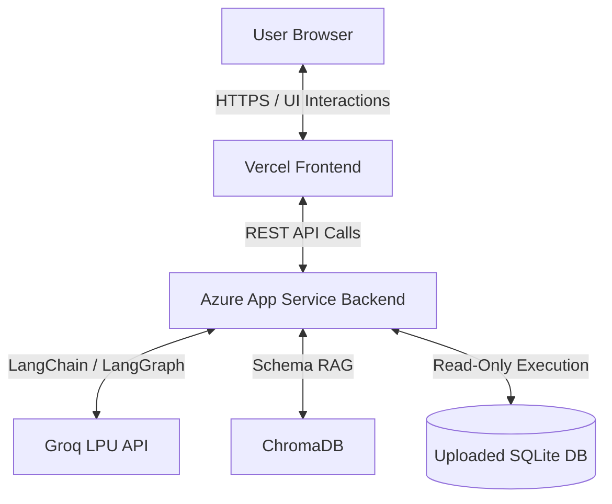
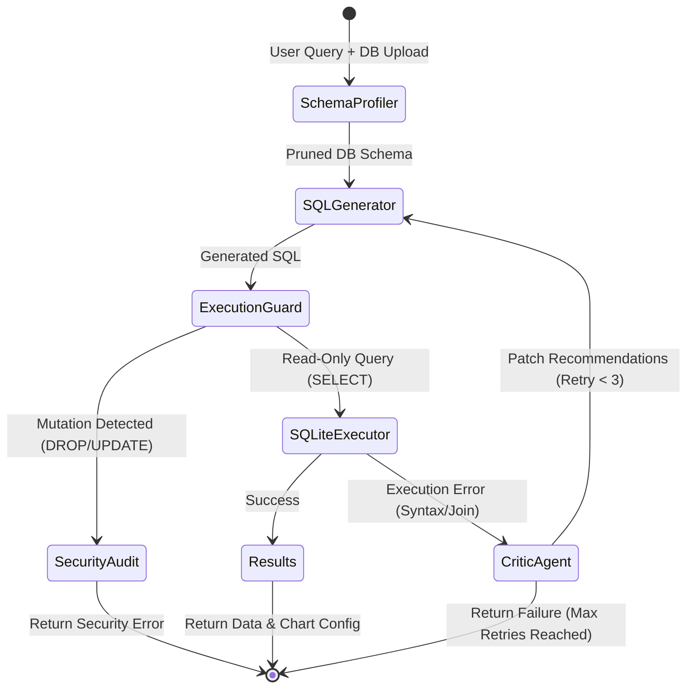

# Autonomous Multi-Agent Text-to-SQL System


## Abstract
A Master's-level, production-grade AI system that autonomously translates natural language into secure, executable SQL queries. This decoupled architecture features **Bring-Your-Own-Database (BYOD)** capabilities, allowing dynamic profiling and querying of any uploaded SQLite database without hardcoded schemas. The intelligence layer is governed by a **LangGraph** state machine utilizing the Groq LPU engine, featuring a self-healing Critic agent and strict AST/Regex execution guardrails.

---

## 🌟 Key Features

*   **Dynamic BYOD (Bring Your Own Database):** Upload any SQLite file (`.db`, `.sqlite3`). The system dynamically extracts structural metadata and uses ChromaDB for schema pruning.
*   **Self-Healing Agentic Loop:** If an initial SQL query fails, a Critic Agent analyzes the SQLite traceback and autonomously patches the query (up to 3 retries).
*   **Security First:** Strict regex/AST-based execution guard blocks all mutation commands (`DROP`, `DELETE`, `UPDATE`, `INSERT`), logging violations to a security audit file.
*   **Immersive Frontend:** Quantum Minimalist UI with preserved particle swarm kinetics, dynamic chart generation (Chart.js), semantic currency formatting, and one-click query copying.
*   **Cloud Native:** Fully decoupled architecture ready for production deployment (Azure Backend + Vercel Frontend).

---

## 🏗️ System Architecture



---

## 🧠 LangGraph State Machine Flow



---

## 💻 Tech Stack

**Backend (AI & API Engine):**
*   **Framework:** FastAPI, Uvicorn, Gunicorn
*   **AI/Orchestration:** LangChain, LangGraph
*   **LLM Provider:** Groq (`llama-3.1-8b-instant`)
*   **Vector Store:** ChromaDB
*   **Data Processing:** Pandas, SQLite3

**Frontend (UI & Visualizations):**
*   **Technologies:** Vanilla HTML5, CSS3, JavaScript (ES6+)
*   **Visualizations:** Chart.js (with dynamic Doughnut/Bar chart routing)
*   **Styling:** Tailwind CSS classes (injected), Custom CSS Animations

---

## 🚀 Local Development Setup

### 1. Backend (FastAPI)
```bash
# Clone the repository
git clone https://github.com/yourusername/enterprise-text-to-sql.git
cd enterprise-text-to-sql/backend

# Set up virtual environment
python -m venv .venv
source .venv/bin/activate  # On Windows use: .venv\Scripts\activate

# Install dependencies
pip install -r requirements.txt

# Set Environment Variables
export GROQ_API_KEY="your_groq_api_key_here"

# Run the local server
uvicorn main:app --reload --port 8000
```

### 2. Frontend (HTML/JS)
```bash
# Open a new terminal window
cd ../frontend

# Update the API_BASE in script.js (if not already set for local)
# const API_BASE = "http://127.0.0.1:8000";

# Serve using any local web server, e.g., Python's built-in server:
python -m http.server 3000
```
*Visit `http://localhost:3000` in your browser.*

---

## ☁️ Production Deployment Guide

### Backend: Deploying to Azure App Service
1.  **Push Code:** Connect your GitHub repository to an Azure Web App (Python 3.10+ Linux environment).
2.  **Environment Variables:** In the Azure Portal, go to **Settings > Environment variables** and add:
    *   `GROQ_API_KEY`: `your-api-key`
    *   `WEBSITES_ENABLE_APP_SERVICE_STORAGE`: `true` (Required to persist uploaded SQLite files).
3.  **Startup Command:** Go to **Settings > General settings** and set the Startup Command to:
    ```bash
    gunicorn --bind=0.0.0.0:8000 --timeout 300 -w 2 -k uvicorn.workers.UvicornWorker backend.main:app
    ```
4.  **Verify:** Visit `https://<your-azure-domain>.azurewebsites.net/docs` to see the active Swagger UI.

### Frontend: Deploying to Vercel
1.  **Update API URL:** In `frontend/script.js`, update `API_BASE` to your Azure production URL (ensure there are no brackets or trailing slashes):
    ```javascript
    const API_BASE = "https://<your-azure-domain>.azurewebsites.net";
    ```
2.  **Import Project:** In Vercel, import your Git repository.
3.  **Set Root Directory:** During configuration, edit the **Root Directory** to point to the `frontend` folder.
4.  **Deploy:** Click Deploy. Vercel will serve your static files and route API calls to Azure.

---

## 🧪 Testing the System (Usage Example)

To test the system's capabilities, download the sample [Chinook Database](https://www.sqlitetutorial.net/sqlite-sample-database/) (`chinook.db`).

1.  Drag and drop `chinook.db` into the frontend upload zone.
2.  Wait for ChromaDB indexing to complete.
3.  Enter the following prompt:
    > *"What is the total revenue generated by each music genre, sorted from highest to lowest?"*
4.  **Expected Output:** The AI will generate a multi-table JOIN query, execute it securely, format the results as USD currency, and render a dynamic Chart.js visualization.

---

## 🛡️ Security & Guardrails
*   **Read-Only Enforcement:** The AST/Regex execution guard intercepts statements matching `(?i)\b(DROP|DELETE|UPDATE|INSERT|ALTER|TRUNCATE|GRANT|REVOKE)\b`.
*   **Audit Logging:** All blocked queries are recorded in `security_audit.log` with a timestamp and the raw query text.
*   **Session Management:** Uploaded databases are temporary and isolated to the active session path.
